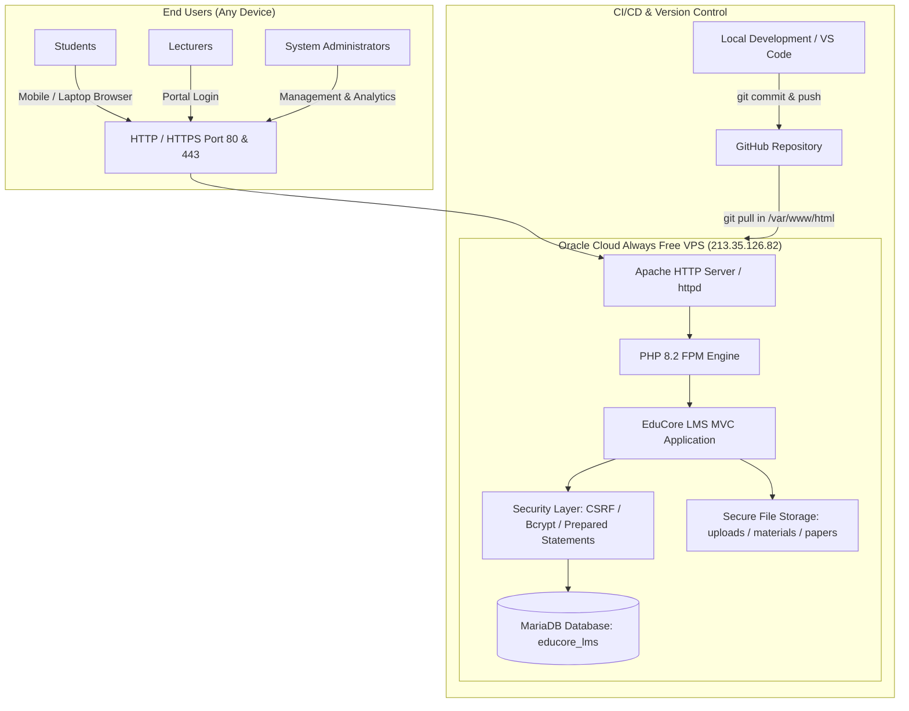

# EduCore LMS - Secure Online Learning Management System
### NVTI Baddegama - ICT NVQ Level 5 Diploma Project

---

## 🎯 Overview
**EduCore LMS** is a full-featured, secure, and responsive web-based Learning Management System specially engineered for the **National Diploma in Information & Communication Technology (NVQ Level 5)** at **NVTI Baddegama**.

The system caters to the real operational structure with:
- **Teacher 01 (Morning Shift: 09:00 AM – 12:00 PM)**
- **Teacher 02 (Afternoon Shift: 01:00 PM – 04:00 PM)**
- **Role-Based Portals**: System Admin, Lecturers (Teachers), and Enrolled Students.

---

## 🔑 Administrative & Academic Credentials

| Role | Name / Shift | Email | Default Password |
| :--- | :--- | :--- | :--- |
| **Master Admin** | System Administrator | `admin@nvti.edu.lk` | `AdminPassword123!` |
| **Academic Admin**| U.G.P.K. Nishantha Sir | `nishantha@nvti.edu.lk` | `nvtiadmin123` |
| **Academic Admin**| Gayan Sir | `gayan@nvti.edu.lk` | `nvtiadmin123` |
| **Teacher 01** | Morning Lecturer (09:00 - 12:00) | `teacher1@nvti.edu.lk` | `TeacherPassword123!` |
| **Teacher 02** | Afternoon Lecturer (13:00 - 16:00) | `teacher2@nvti.edu.lk` | `TeacherPassword123!` |
| **Student** | Kasun Madushanka | `student@nvti.edu.lk` | `StudentPassword123!` |

---

## 🗺️ System Architecture & Deployment Roadmap



---

## 🚀 Production Deployment & Continuous Git Updates

### Updating the Live Server via Git:
Whenever changes are made and pushed to GitHub, simply SSH into the server and run:
```bash
cd /var/www/html
git pull origin main
```
The live instance updates in seconds!

---

## 🌐 Localhost Access URL
```
http://localhost/nvti%20baddegama%20diploma/
```

---

## 🚀 Key Features

### 1. Admin Panel
- **Comprehensive KPI Dashboard**: Total students, lecturers, courses, materials, assignments, and submissions.
- **Student Management**: View student profiles, approve pending registrations, activate/suspend accounts, delete students.
- **Lecturer Management**: Manage lecturer profiles, assign morning/afternoon shifts, and allocate subjects.
- **Class Timetable Management**: Schedule daily morning (09:00 - 12:00) and afternoon (13:00 - 16:00) lecture sessions, allocate computer labs.
- **Courses & Subjects**: Manage NVQ Level 5 modules (ICT501 to ICT504) and class batches.
- **Security & Audit Logs**: Real-time logging of authentication attempts, IP addresses, and critical system activities.

### 2. Teacher Panel
- **Shift & Subject Overview**: Dedicated view for assigned teaching slots.
- **Learning Materials Upload**:
  - Lecture Notes (PDF)
  - Past Examination Papers
  - Model Papers & Marking Schemes
  - Lab Tutorials & Worksheets
  - Diagram & Architecture Images
  - YouTube Video Lessons (curated links)
  - External Resources & Documentation links
- **Assignment Management**: Create assignments with detailed instructions, deadlines, total marks, and reference files.
- **Submission Review & Grading**: Download student uploaded answer files, enter marks (validated against maximum marks), and write qualitative feedback.
- **Lecturer Timetable**: Personal schedule view of morning/afternoon sessions.

### 3. Student Panel
- **Student Dashboard**: Enrolled course details, student registration code (e.g. `NVTI-ST-2026-001`), upcoming deadlines, and announcements.
- **Material Downloads**: Filter materials by subject and category, search keywords, watch embedded YouTube video lectures, and safely download notes/papers.
- **Assignment Submissions**: Upload coursework answers (PDF, DOCX, ZIP), add remarks, track submission status (Submitted, Graded, Resubmission Required, Late).
- **Results & Feedback**: View awarded marks and read feedback provided by lecturers.
- **Personal Timetable**: Morning and afternoon session timetable with laboratory venues.
- **Profile & Password Management**: View profile details and securely update account password.

---

## 🛡️ Security Architecture
- **Authentication**: `password_hash()` and `password_verify()` utilizing modern Bcrypt hashing.
- **SQL Injection Defense**: Strict PDO native prepared statements (`ATTR_EMULATE_PREPARES => false`).
- **CSRF Protection**: Cryptographically secure random CSRF tokens validated on all state-changing `POST` requests.
- **XSS Protection**: HTML special character escaping on all dynamic outputs (`Sanitizer::e()`).
- **File Upload Protection**:
  - Verification of MIME types (`finfo`) and strict extension whitelisting.
  - Safe randomized filenames (`bin2hex(random_bytes(16))`) preventing overwriting and execution.
  - Storage protected via `.htaccess` (Deny from all direct access).
  - Protected streaming download handler with path-traversal prevention (`realpath()` inspection).
- **Session Security**: Cookie `HttpOnly`, `SameSite=Lax`, and session ID regeneration on login.

---

## 🗄️ Database Structure (`educore_lms`)
1. `users` – Core user accounts (Admin, Teacher, Student)
2. `student_profiles` – Student codes, NIC, phone, address, course & class IDs
3. `teacher_profiles` – Teacher codes, qualification, preferred slot (Morning/Afternoon)
4. `courses` – Academic programs (NVQ Level 5)
5. `classes` – Batch representations
6. `subjects` – Course modules
7. `class_subjects` – Pivot connecting classes and subjects
8. `teacher_assignments` – Allocating teachers to class subjects
9. `enrollments` – Student class enrollments
10. `class_sessions` – Timetable sessions with morning/afternoon shifts
11. `categories` – Resource categories (Notes, Papers, Tutorials, YouTube, Links)
12. `materials` – Uploaded files and resources
13. `assignments` – Assignment titles, instructions, deadlines, marks
14. `submissions` – Student files, timestamps, marks, feedback, status
15. `announcements` – Institute announcements
16. `audit_logs` – Activity tracking
17. `login_logs` – Login attempt tracking
18. `password_resets` – Tokenized password reset tracking

---

## 💻 Tech Stack
- **Backend**: PHP 8.0+
- **Database**: MySQL / MariaDB (InnoDB, UTF-8 MB4)
- **Frontend**: HTML5, CSS3, JavaScript (ES6+), Bootstrap 5.3, Bootstrap Icons
- **Server**: Apache (XAMPP)
